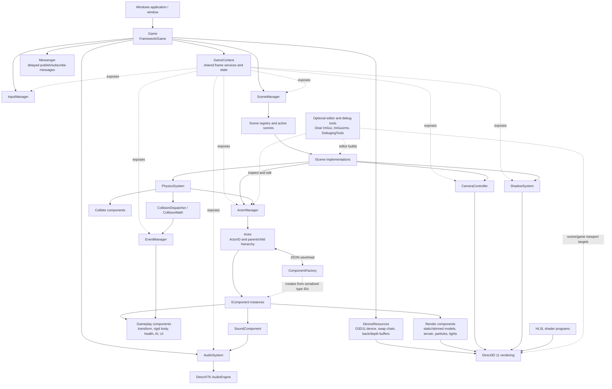

# HEIN Engine Architecture

This overview reflects the engine structure in the repository. The engine is a Windows C++20 static library built around Direct3D 11 and DirectXTK. `Game` owns the frame loop and shared services; registered `IScene` implementations supply game-specific update and rendering behavior.

## Runtime flow

`Game::Tick()` advances the `StepTimer`, calls `Game::Update()`, then renders. Update samples keyboard and mouse state, updates the input manager and messenger, and delegates scene updates to `SceneManager`; audio is advanced with the active camera position when available. Rendering clears the D3D11 target and asks `SceneManager` to render active scenes, followed by the editor UI when editor support is enabled.

Scenes implement `IScene::Update` and `IScene::Render`. They use `GameContext` to reach shared engine services and coordinate actor/component and system work. `ActorManager` owns actors by `ActorID`; each actor owns its components and drives their lifecycle and draw callbacks. The physics module queries actors and colliders, resolves solid overlaps, and dispatches trigger events through `EventManager`.

`ComponentFactory` maps component type names to constructors for actor JSON deserialization. Render components and HLSL programs feed the Direct3D 11 pipeline. Audio is a separate engine-wide service: `SoundComponent` submits cues while `AudioSystem` manages playback, buses, spatial positions, and BGM transitions.

## Main modules

- `Framework/` — `Game`, the frame loop, and the shared `GameContext`.
- `Scene/` — scene registration, lifecycle, transitions, and rendering delegation.
- `Entities/`, `Components/`, `Factory/` — actor/component model, component registry, and serialization support.
- `System/`, `Common/`, `Camera/` — physics/collision, audio and shadow services, device/input/event resources, and camera modes.
- `Shaders/`, `Effect/`, `DirectXTK_Utilities/` — HLSL programs and rendering/animation helpers.
- `DebugingTools/`, `ImGui/` — optional editor, gizmo, and debug UI support.
- `BehaviourTree/`, `Message/` — behavior-tree building blocks and message/observer utilities.

The repository contains the engine library and infrastructure; application entry points and concrete game scenes are provided by consuming applications rather than this project.
